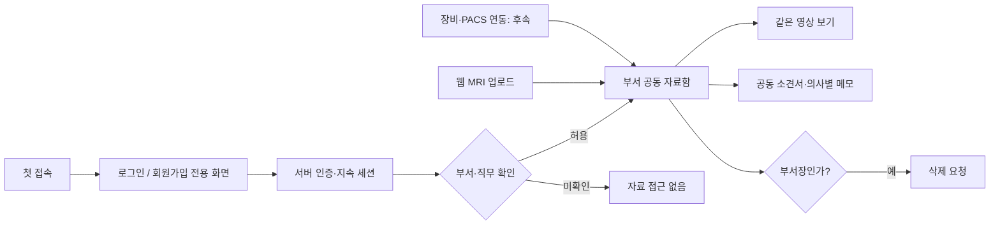

> v2 시점의 설계 기록입니다. v3의 실제 구현·실행 방법·제한은 README.md를 기준으로 확인하세요.

# Medical Web v2 · 기능 설계안

상태: 설계안. 로그인, 회원가입, 공동 자료함, 소견서, 메모, 장비 연동은 아직 구현하지 않는다. 원본 소스는 변경하지 않는다.
시각 기준: 별도로 전달된 DESIGN_STYLE.md. 기존 영상 작업 화면의 색상·크기·간격·섹션 순서·요소 ID를 유지한다.

## 확정된 요구사항

1. 첫 화면은 로그인·회원가입 전용이다. 미인증 상태에는 의료 영상 작업 화면과 그 HTML/JS, 내부 API 정보, 자료 목록을 보내지 않는다.
2. 회원가입이 가능하다. 가입만으로 부서의 의료 자료 열람 권한을 주지 않는다. 사용자와 부서·직무의 연결은 신원 확인 후 부여한다.
3. 유효한 로그인 상태는 브라우저를 닫았다 열어도 이어진다. 로그아웃, 만료, 계정 비활성화 시 서버에서 무효화한다.
4. 같은 부서·직무에 속한 의사는 같은 MRI 자료와 분석 결과를 열 수 있다.
5. 같은 부서 의사는 소견서를 함께 수정하고, 각자 메모를 남겨 동료가 볼 수 있다.
6. 해당 부서의 최고 관리자 의사(부서장)만 자료 삭제를 요청할 수 있다. 일반 의사에게 삭제 권한을 주지 않는다.
7. 프로토타입은 웹페이지의 MRI 파일 직접 업로드를 우선 구현한다. 장비·PACS 자동 전송도 필요하지만 후속 연결 단계로 둔다.

## 화면과 자료 흐름

## 권한표

| 사용자 | 영상·결과 열람 | 업로드·분석 | 소견서 수정 | 메모 작성·열람 | 자료 삭제 |
|---|---|---|---|---|---|
| 미인증 | 불가 | 불가 | 불가 | 불가 | 불가 |
| 가입 후 부서 미확인 | 불가 | 불가 | 불가 | 불가 | 불가 |
| 같은 부서·직무 의사 | 허용 | 허용 | 허용 | 허용 | 불가 |
| 해당 부서장 의사 | 허용 | 허용 | 허용 | 허용 | 허용 |
| 다른 부서 의사 | 불가 | 불가 | 불가 | 불가 | 불가 |

부서·직무 연결과 부서장 지정은 서버의 권한 데이터로 관리한다. 회원가입 폼에서 사용자가 스스로 부서장이나 다른 부서 소속을 선택해 권한을 얻을 수 없게 한다. 모든 화면, API, 파일 다운로드에서 서버가 세션과 부서·직무·역할을 검사한다.

## 화면 구성 제안

- 공개 화면: 기존 디자인의 색상 토큰, 글꼴, 입력, 버튼, 구분선을 쓰는 로그인·회원가입 화면만 제공한다. 작업 기능 이름과 정적 앱 코드는 제공하지 않는다.
- 로그인 후: 현재 의료 영상 작업 화면에 부서 공동 자료 선택, 소견서, 메모 영역을 추가한다. 실제 구현 시 DESIGN_STYLE.md에 맞는 위치와 컴포넌트를 먼저 확정한다.
- 공동 자료 한 건은 검사(study) 단위로 묶는다. 원본 MRI, 분석 결과, 소견서, 메모, 작성·수정 이력을 같은 검사에 연결한다. 의사마다 영상을 복제하지 않는다.
- 소견서는 같은 부서 의사가 수정할 수 있다. 저장 때 버전 번호를 확인해 동시 수정이 다른 의사의 내용을 덮어쓰지 않게 하고, 이전 버전·수정자·수정 시각을 남긴다.
- 메모는 작성자와 시각을 표시하며 같은 부서 의사가 볼 수 있다. 기본적으로 작성자는 본인 메모만 수정하고, 모든 변경 기록을 남긴다.
- 삭제 버튼은 부서장에게만 보이되, 실제 삭제 권한은 서버가 다시 검사한다. 삭제 대상과 시각을 감사 기록에 남긴다. 복구 및 영구 삭제 정책은 구현 전에 확정한다.

## 서버 구조 변경점

- 현재 backend/app.py의 루트 StaticFiles 마운트는 미인증 사용자에게 frontend/index.html을 전달할 수 있으므로 보호 경로로 바꾼다. 공개 로그인·회원가입 화면만 별도 응답한다. 프런트엔드에서 화면을 숨기는 것만으로는 목표를 달성할 수 없다.
- 사용자·부서·직무·역할·세션·검사·파일·소견서 버전·메모·감사 기록을 지속 저장소에 둔다. 현재 jobs 메모리 딕셔너리는 공동 열람과 재방문에 부족하므로 작업·결과 메타데이터도 저장한다.
- 가입, 로그인, 로그아웃, 현재 사용자 확인 API를 추가한다. 영상 업로드·다운로드, 작업 생성·조회, transform, 소견서, 메모, 삭제 API에 요청마다 권한 검사를 둔다.
- 브라우저에는 불투명한 세션 ID만 HttpOnly·Secure·SameSite 쿠키로 둔다. HTTPS, 서버 측 세션 만료·철회, 변경 요청의 CSRF 방어, 로그인 시도 제한을 적용한다. 지속 로그인은 무기한 로그인을 뜻하지 않는다.
- 로그인·가입 실패는 계정 존재 여부가 드러나지 않는 공통 응답을 사용한다. 민감한 응답은 브라우저 캐시와 서버 오류 메시지로 누출되지 않도록 한다.
- 현재 업로드는 NIfTI .nii/.nii.gz 전용이다. 프로토타입의 웹 업로드를 먼저 사용하고, 장비·PACS 연동 시 DICOM 수신·검사 식별·영상 변환 경계를 추가한다. 장비가 지원하는 전송 방식은 연결 전에 확인한다.

## 사용자가 로직을 확인하는 방법

1. 위 화면 흐름 그림으로 인증, 공동 자료, 소견서·메모, 삭제 권한의 위치를 본다.
2. 권한표로 각 역할이 가능한 동작을 확인한다.
3. 요청 예시를 순서대로 본다: 회원가입 → 로그인 → 부서 확인 → MRI 업로드 → 동료 열람 → 공동 소견서·메모 → 부서장 삭제.
4. 검증 시나리오를 본다: 미인증 앱 소스/API 차단, 브라우저 재시작 후 로그인 유지, 다른 부서 접근 거부, 동시 소견서 수정 충돌, 일반 의사 삭제 거부, 부서장 삭제 기록.

## 구현 전에 결정할 값

- 부서·직무 확인을 누가 어떻게 수행할지.
- 로그인 유지 기간과 비밀번호 재설정 방식.
- 소견서 최종 확정·서명·잠금이 필요한지.
- 메모를 작성자만 수정할지, 같은 부서가 공동 수정할지.
- 삭제 후 복구 기간과 영구 삭제 정책.
- 장비·PACS의 실제 DICOM 전송 방식과 웹 업로드 파일 형식.
- 기존 data/ 파일을 어느 부서와 검사에 귀속할지.

참고: https://cheatsheetseries.owasp.org/cheatsheets/Authentication_Cheat_Sheet.html
참고: https://cheatsheetseries.owasp.org/cheatsheets/Session_Management_Cheat_Sheet
참고: https://cheatsheetseries.owasp.org/cheatsheets/Authorization_Cheat_Sheet.html
참고: https://cheatsheetseries.owasp.org/cheatsheets/Password_Storage_Cheat_Sheet.html
참고: https://cheatsheetseries.owasp.org/cheatsheets/Cross-Site_Request_Forgery_Prevention_Cheat_Sheet.html
참고: https://dicom.nema.org/medical/dicom/2026c/output/chtml/part04/PS3.4.html
